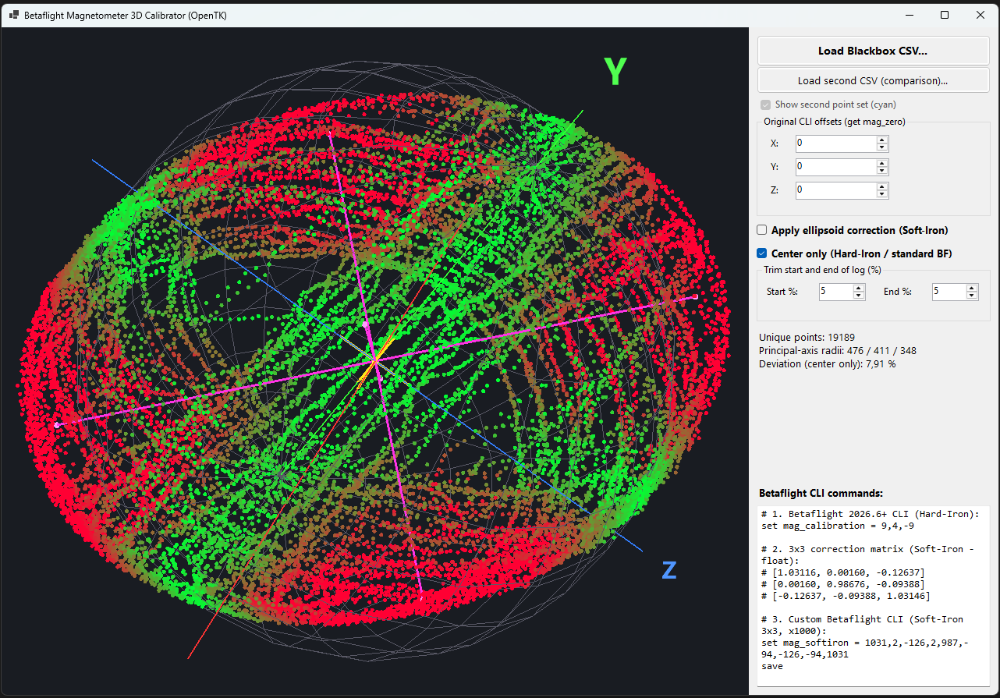
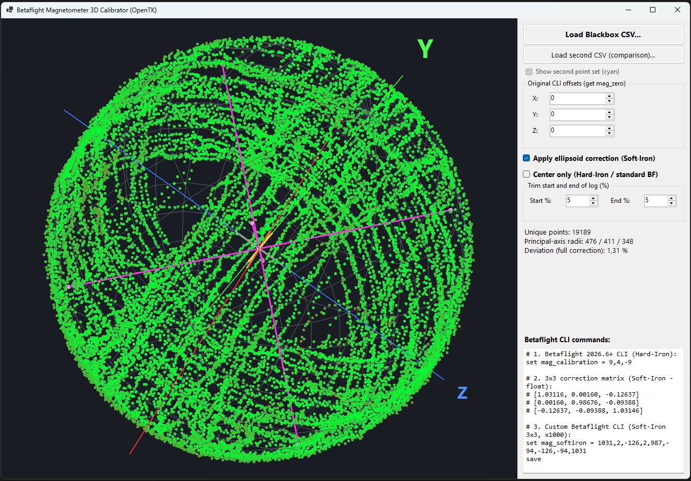
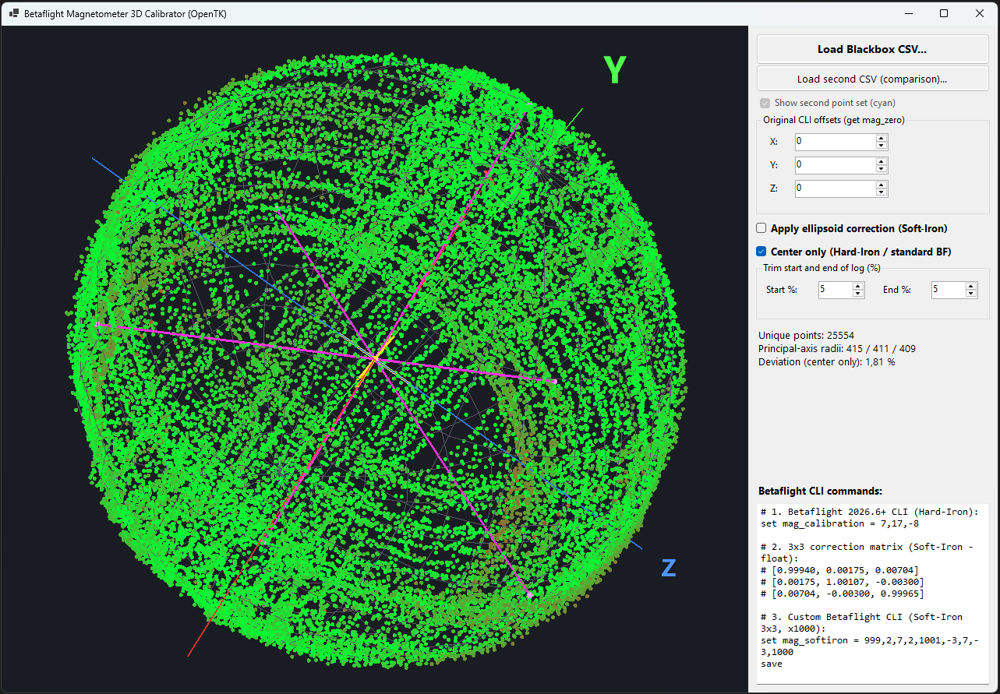

# Betaflight Magnetometer 3D Calibrator

A Windows desktop application for visualizing and calibrating drone magnetometer data collected with **Betaflight BlackBox**.

The application loads BlackBox CSV logs, extracts magnetometer samples, fits an ellipsoid to the measured data, calculates hard-iron and soft-iron calibration parameters, and displays the result in an interactive 3D view.

> This project is intended for Betaflight magnetometer calibration using data from BlackBox logs.

## Features

- Load a Betaflight BlackBox CSV file.
- Read magnetometer columns `magADC[0]`, `magADC[1]`, and `magADC[2]`.
- Remove duplicate and zero-valued samples.
- Trim a configurable percentage from the beginning and end of a recording.
- Enter existing Betaflight magnetometer offsets from `get mag_zero`.
- Fit a general, rotated 3D ellipsoid to the measured data.
- Calculate:
  - the hard-iron center offset;
  - the principal ellipsoid radii;
  - a 3x3 soft-iron correction matrix;
  - the principal axes of the measured ellipsoid.
- Compare the application's Jacobi-based correction with the current Betaflight Configurator approach.
- Compare two BlackBox measurements in the same visualization.
- Display raw, center-only, or fully corrected data.
- Inspect calibration quality using the calculated deviation percentage.
- Generate Betaflight CLI-oriented calibration output.
- Rotate the 3D scene with the mouse and zoom with the mouse wheel.
- Start with generated simulated ellipsoid data, allowing the application to be tested without a CSV file.

## Calibration concepts

Magnetometer calibration commonly involves two types of error:

### Hard-iron error

Hard-iron error is an additive offset caused by permanent magnetic fields near the sensor, such as motors, wiring, screws, or other components. The application estimates this as the center of the fitted ellipsoid.

### Soft-iron error

Soft-iron error changes the shape and orientation of the measured magnetic field. The ideal measurement distribution is a sphere, but distortions produce an ellipsoid. The application calculates a symmetric 3x3 transformation matrix that maps the fitted ellipsoid toward a sphere.

The full correction therefore consists of:

1. Subtracting the fitted center from each measurement.
2. Applying the calculated 3x3 soft-iron matrix.

The **Center only (Hard-Iron / standard BF)** option applies only the center offset and leaves the ellipsoid shape visible. The **Apply ellipsoid correction (Soft-Iron)** option applies both corrections.

## Comparison with Betaflight Configurator

The project also contains an independent implementation intended for comparison with the current magnetometer calibration implementation in **Betaflight Configurator**.

The application calculates the primary soft-iron matrix using the eigenvalues and eigenvectors of the fitted ellipsoid's symmetric quadratic matrix. This is referred to in the application as the **Jacobi** method. A second matrix is calculated using a **Cholesky decomposition** of the same normalized ellipsoid matrix, following the lower-triangular correction approach used for comparison with the current Betaflight Configurator implementation.

The comparison code:

- calculates both correction matrices from the same fitted measurement data;
- compares the transformed vectors point by point;
- reports the maximum angular difference between the two corrected vectors;
- extracts and reports the total rotational component of each matrix;
- reports the Roll, Pitch, and Yaw components of both matrix rotations.

When a second BlackBox dataset is loaded and enabled, the application prioritizes the dataset comparison report instead, because both reports cannot be displayed clearly in the available CLI output area. Disable the second dataset to inspect the Jacobi-versus-Cholesky comparison.

This comparison is intended as an engineering and validation aid. It helps determine whether the correction produced by this project is directionally consistent with the current Betaflight Configurator implementation. Small numerical or matrix-structure differences are possible because the two methods can represent the same ellipsoid transformation using different matrix forms. Always validate the resulting calibration on the actual flight controller.

## Requirements

- Windows 10 or later.
- .NET 10 SDK or a compatible .NET 10 Windows runtime.
- A graphics environment that supports OpenGL through OpenTK.
- A Betaflight BlackBox CSV log containing magnetometer data.

The project targets:

```text
net10.0-windows
```

## Building and running

Clone the repository and build the project with the .NET CLI:

```powershell
git clone https://github.com/CZ-Pascal/Drone_MagSphereCalibration
cd Drone_MagSphereCalibration
dotnet restore
dotnet build
dotnet run
```

Alternatively, open `Drone_MagSphereCalibration.slnx` or `Drone_MagSphereCalibration.csproj` in Visual Studio and run the project.

The application uses the `OpenTK.GLControl` NuGet package for the interactive OpenGL visualization.

## Using the application

### 1. Load a BlackBox CSV file

Click **Load Blackbox CSV...** and select a Betaflight BlackBox CSV file. The application searches for these columns:

```text
magADC[0]
magADC[1]
magADC[2]
```

Rows with all three values equal to zero are ignored. Duplicate points are removed before calibration.

At least 20 usable samples are required for recalculation. In practice, a much larger and well-distributed dataset is recommended.

### 2. Enter existing offsets

If the flight controller already has magnetometer offsets, enter the values from the Betaflight CLI command:

```text
get mag_zero
```

Use the X, Y, and Z fields under **Original CLI offsets (get mag_zero)**. These values are added to the loaded samples before fitting.

### 3. Trim the recording

Use **Start %** and **End %** to remove samples from the beginning and end of the log. Trimming can help exclude periods where the sensor was stationary or where the recording contains unwanted motion.

The default is 5% at each end. The allowed range is 0% to 45% for each side.

### 4. Select the correction mode

- **Apply ellipsoid correction (Soft-Iron)**: applies the fitted center and 3x3 correction matrix.
- **Center only (Hard-Iron / standard BF)**: applies only the fitted center offset.
- With both options disabled, the raw data is displayed without calibration.

The statistics panel reports the number of unique points, the three principal-axis radii, and the deviation from the fitted sphere for the selected mode.

### 5. Inspect the 3D visualization

The visualization contains:

- X, Y, and Z coordinate axes.
- A reference wireframe sphere.
- The calibrated point cloud.
- A yellow center marker.
- Magenta ellipsoid principal axes.
- Optional cyan points from a second measurement.

Controls:

- Hold the left mouse button and drag to rotate the scene.
- Use the mouse wheel to zoom.

### 6. Compare a second measurement

Click **Load second CSV (comparison)...** to load another BlackBox recording. Enable or disable **Show second point set (cyan)** to control its visibility.

The comparison report includes:

- center offset between the two fitted ellipsoids;
- rotation of the longest principal axis;
- difference in ellipsoid shape ratios;
- error of the second dataset when evaluated with the first dataset's calibration.

This can be useful for checking whether two recordings produce consistent calibration results.

## Calibration example

The following screenshots show a complete calibration workflow using Betaflight BlackBox data. The example compares measurements before and after applying a soft-iron correction in the flight-controller firmware.

### Before correction



This view shows magnetometer data recorded from BlackBox while the firmware had no soft-iron correction enabled. The measured points form a distorted ellipsoid rather than a sphere. This distortion represents scale differences and axis coupling introduced by the sensor installation and surrounding hardware.

### Calculated correction



Using the uncorrected BlackBox data, the application fits a rotated 3D ellipsoid and calculates the corresponding calibration parameters. The displayed result includes the estimated hard-iron center, principal-axis radii, ellipsoid axes, calibration deviation, and the 3x3 soft-iron correction matrix generated for Betaflight integration.

The matrix is calculated from the measured ellipsoid so that, after subtracting the fitted center and applying the matrix, the distorted point cloud is transformed toward a sphere.

### After correction



This view shows a new BlackBox dataset recorded after the calculated soft-iron correction matrix was applied in the Betaflight firmware. The measurement distribution is substantially closer to a sphere, demonstrating the effect of applying the correction during sensor processing.

The soft-iron correction feature is currently an extension to the original Betaflight firmware. Standard upstream Betaflight does not yet include this functionality. The author intends to submit the implementation as a pull request so that future Betaflight versions can support this correction natively.

## Betaflight CLI output

The application displays generated output in the **Betaflight CLI commands** panel. It includes:

- the calculated center calibration values;
- the floating-point 3x3 soft-iron matrix;
- the matrix coefficients scaled by 1000;
- a `save` command.

Example output structure:

```text
# 1. Betaflight 2026.6+ CLI (Hard-Iron):
set mag_calibration = <x>,<y>,<z>

# 2. 3x3 correction matrix (Soft-Iron - float):
# [m00, m01, m02]
# [m10, m11, m12]
# [m20, m21, m22]

# 3. Custom Betaflight CLI (Soft-Iron 3x3, x1000):
set mag_softiron = <m00>,<m01>,<m02>,<m10>,<m11>,<m12>,<m20>,<m21>,<m22>
save
```

Always verify the generated commands against the Betaflight version and configuration used by your flight controller before applying them. The custom soft-iron command may require corresponding firmware support or an integration not included in standard Betaflight builds.

## Collecting suitable BlackBox data

For a useful calibration dataset:

- move the drone through many orientations so the magnetometer samples cover the full 3D field;
- rotate around all three axes rather than only turning the drone flat on a table;
- keep the sensor and nearby equipment in the same physical configuration used during flight;
- avoid large changes in distance to magnetic objects;
- keep motors and other magnetic sources in the intended operating configuration when collecting data;
- collect substantially more than the minimum 20 points;
- inspect the point distribution in the 3D view before trusting the result.

A dataset covering only a plane or a small range of orientations can produce an unstable or invalid ellipsoid fit.

## Project structure

```text
Drone_MagSphereCalibration/
├── Form1.cs                         # Main Windows Forms UI, visualization, parsing, and calibration logic
├── Form1.resx                       # Windows Forms resources
├── Program.cs                       # Application entry point
├── Drone_MagSphereCalibration.csproj # Project and package configuration
└── Drone_MagSphereCalibration.slnx  # Visual Studio solution
```

## Technical implementation

- C# Windows Forms application.
- .NET 10 for Windows.
- OpenTK 4.0.2 for OpenGL rendering and 3D mathematics.
- CSV parsing based on the required Betaflight `magADC` column names.
- Duplicate filtering with a `HashSet<Vector3>`.
- Ellipsoid fitting using a least-squares system.
- Eigenvalue and eigenvector calculation using a Jacobi method for a symmetric 3x3 matrix.
- OpenGL immediate-mode rendering through `GLControl`.

## Limitations

- The application currently expects comma-separated CSV data and the exact `magADC[0]`, `magADC[1]`, and `magADC[2]` headers.
- The CSV parser is intentionally lightweight and is not a full CSV dialect implementation.
- Calibration quality depends on the coverage and quality of the input data.
- The application does not write calibration values directly to a flight controller.
- Generated CLI commands must be reviewed manually before use.
- The project is currently Windows-specific because it uses Windows Forms and targets `net10.0-windows`.

## Safety and calibration notes

Magnetometer calibration affects heading and navigation behavior. Validate calibration in a safe environment and confirm the result with Betaflight's own sensor and heading displays before flight. Keep the aircraft away from large ferromagnetic objects and sources of electromagnetic interference during validation.

## License

MIT License

Copyright (c) 2026 Drone_MagSphereCalibration contributors

Permission is hereby granted, free of charge, to any person obtaining a copy
of this software and associated documentation files (the "Software"), to deal
in the Software without restriction, including without limitation the rights
to use, copy, modify, merge, publish, distribute, sublicense, and/or sell
copies of the Software, and to permit persons to whom the Software is
furnished to do so, subject to the following conditions:

The above copyright notice and this permission notice shall be included in all
copies or substantial portions of the Software.

THE SOFTWARE IS PROVIDED "AS IS", WITHOUT WARRANTY OF ANY KIND, EXPRESS OR
IMPLIED, INCLUDING BUT NOT LIMITED TO THE WARRANTIES OF MERCHANTABILITY,
FITNESS FOR A PARTICULAR PURPOSE AND NONINFRINGEMENT. IN NO EVENT SHALL THE
AUTHORS OR COPYRIGHT HOLDERS BE LIABLE FOR ANY CLAIM, DAMAGES OR OTHER
LIABILITY, WHETHER IN AN ACTION OF CONTRACT, TORT OR OTHERWISE, ARISING FROM,
OUT OF OR IN CONNECTION WITH THE SOFTWARE OR THE USE OR OTHER DEALINGS IN THE
SOFTWARE.
